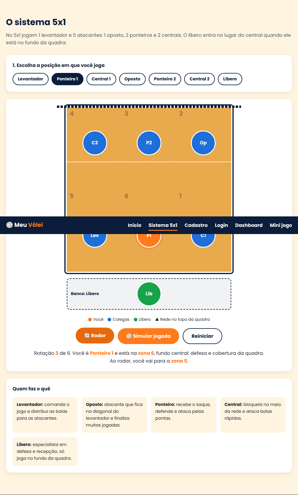
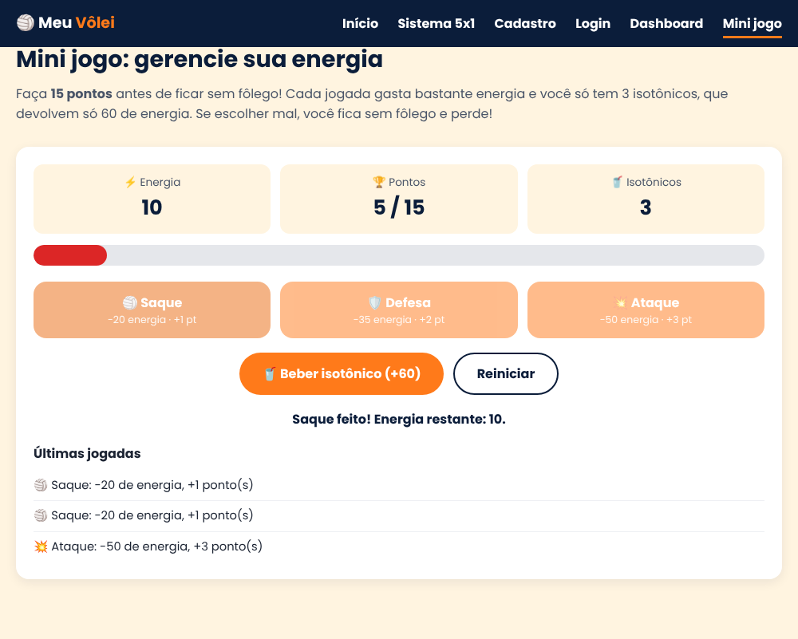
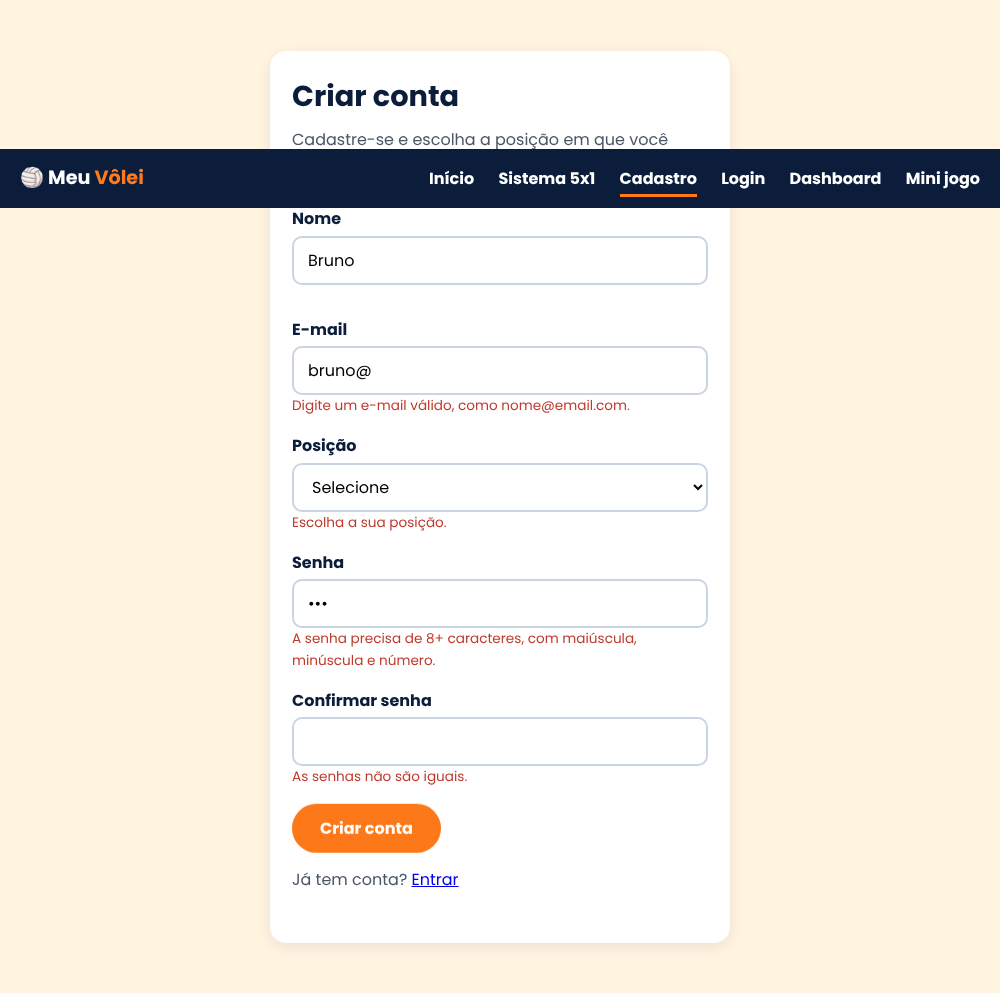
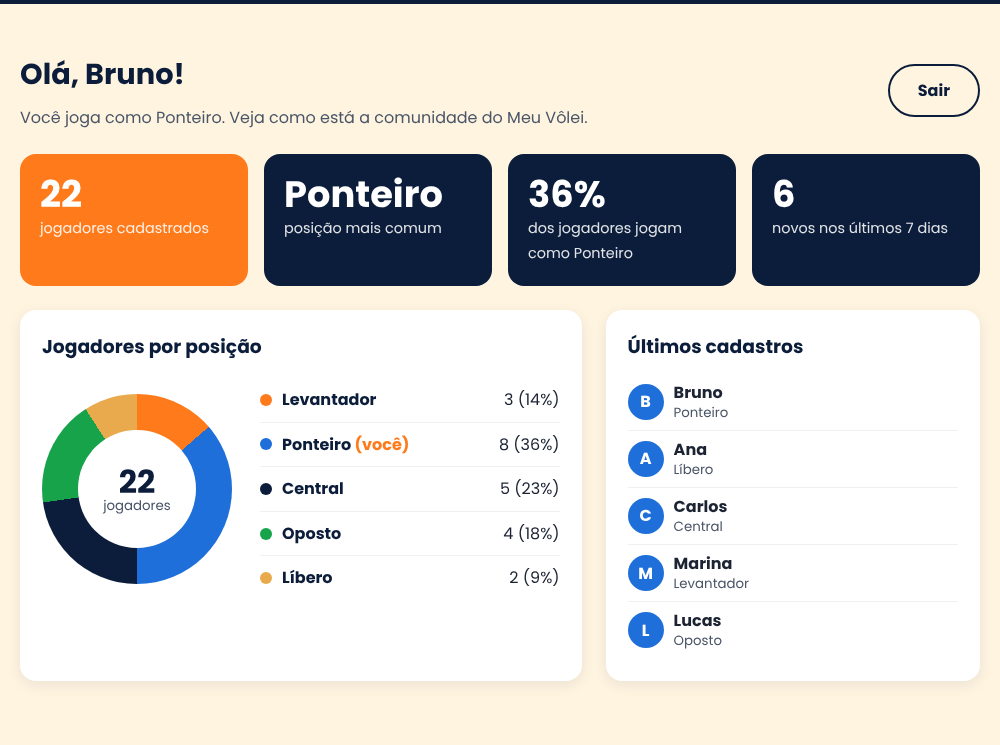
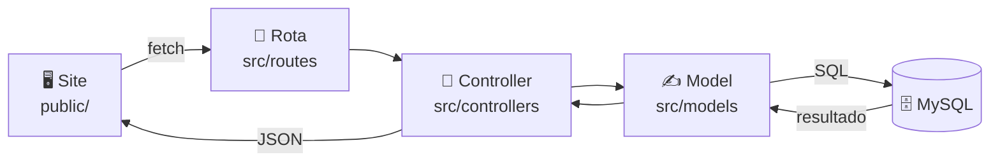
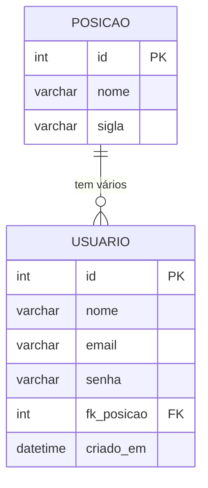

<div align="center">

# 🏐 Meu Vôlei

**Um site sobre vôlei que explica o sistema 5x1 de forma interativa, com cadastro de jogadores, dashboard e um mini jogo.**


Projeto Individual · SPTECH 2026/2

</div>

---

## 📖 Sobre o projeto

O **Meu Vôlei** nasceu para mostrar por que eu gosto de vôlei e para ajudar quem está começando a entender o **sistema 5x1**: o rodízio de posições, as zonas da quadra e a entrada do líbero. O site tem uma quadra interativa, onde a pessoa escolhe a posição em que joga e vê o rodízio acontecer, e uma comunidade de jogadores cadastrados que aparece em um dashboard.

## ✨ Funcionalidades

- 🏠 **Página inicial** com os motivos para gostar de vôlei
- 🔄 **Quadra interativa do 5x1:** escolha sua posição, rode o rodízio e simule uma jogada completa (saque, recepção, levantamento e ataque)
- ✍️ **Cadastro e login** com validações em JavaScript (nome, e-mail, posição e senha forte)
- 📊 **Dashboard** com total de jogadores, posição mais comum, sua posição em porcentagem, novos cadastros da semana e gráfico por posição
- 🥤 **Mini jogo de energia:** faça 15 pontos sem ficar sem fôlego, escolhendo entre saque, defesa e ataque

## 🖼️ Telas

### Página inicial


### Sistema 5x1 interativo


### Mini jogo da energia


### Cadastro com validações


### Dashboard


> O dashboard acima foi gerado com dados de exemplo.

## 🧱 Arquitetura

O caminho de um pedido, do clique até o banco de dados:



### Modelo de dados



## 🛠️ Tecnologias

| Camada | Tecnologias |
|---|---|
| Front-end | HTML5, CSS3, JavaScript |
| Back-end | Node.js, Express, dotenv, cors |
| Banco de dados | MySQL (mysql2) |

## 📁 Estrutura de pastas

```
meu-volei/
├── app.js                  # liga o servidor
├── package.json
├── .env.example            # modelo das variáveis de ambiente
├── public/                 # o site (HTML, CSS e JavaScript)
│   ├── index.html
│   ├── sistema-5x1.html
│   ├── cadastro.html
│   ├── login.html
│   ├── dashboard.html
│   ├── jogo.html
│   └── *.js, style.css
└── src/
    ├── routes/             # recebem os pedidos
    ├── controllers/        # conferem os dados
    ├── models/             # montam e executam o SQL
    └── database/           # conexão e script das tabelas
```

## 🚀 Como rodar

Pré-requisitos: [Node.js](https://nodejs.org/) e [MySQL](https://dev.mysql.com/downloads/).

```bash
# 1. Baixe o projeto
git clone https://github.com/bruno-volpe915/meu-volei.git
cd meu-volei

# 2. Instale as dependências
npm install
```

3. Crie o banco de dados rodando o arquivo `src/database/script-tabelas.sql` no MySQL.
4. Copie o `.env.example` para `.env.dev` e preencha `DB_USER` e `DB_PASSWORD` com os seus dados do MySQL.
5. Inicie o servidor:

```bash
npm start
```

6. Abra **http://localhost:3333** no navegador.

## 🔌 Rotas da API

| Método | Rota | O que faz |
|---|---|---|
| POST | `/usuarios/cadastrar` | Cadastra um novo jogador |
| POST | `/usuarios/autenticar` | Faz o login |
| GET | `/dashboard/jogadoresPorPosicao` | Total de jogadores por posição |
| GET | `/dashboard/ultimosCadastros` | Cinco últimos cadastros |
| GET | `/dashboard/novosUltimos7Dias` | Cadastros da última semana |

## 👤 Autor

**Bruno Volpe Costa**
GitHub: [@bruno-volpe915](https://github.com/bruno-volpe915)

---

<div align="center">Feito com 🏐 e muito código · SPTECH 2026/2</div>
